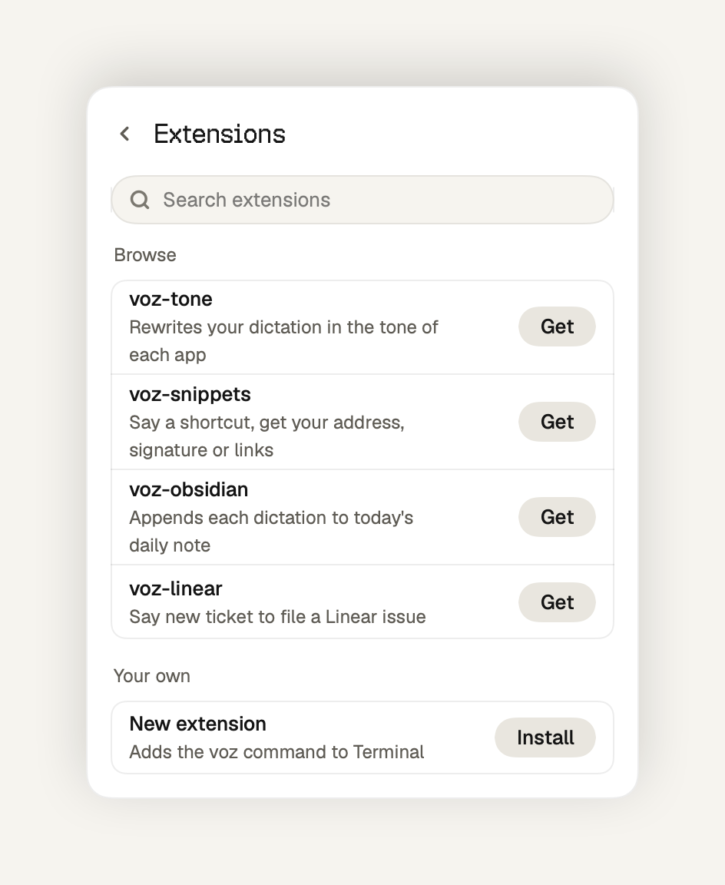

<div align="center">

# Voz

**Free Wispr Flow alternative, extensible like pi.**

[Website](https://voz.joels.tech), [Extensions](https://voz.joels.tech/extensions/)

<picture>
  <source media="(prefers-color-scheme: dark)" srcset=".github/images/ready-dark.png">
  
</picture>

</div>

Tap right Command and talk. Voz types clean text into any app on your Mac. It is open source and runs offline.

## Install

You need macOS 26 and Apple Silicon. Paste this in Terminal:

```
curl -fsSL https://voz.joels.tech/install | bash
```

Voz asks for Microphone, Accessibility and Input Monitoring access, then updates itself.

## Why Voz

Dictation apps charge monthly to talk. They grow a hundred settings, and a change you want waits months on a pull request.

Voz is MIT licensed, with no account and no weekly word limit. The core records, transcribes, cleans up, inserts and saves your history. Nothing else runs on your words. Anything more is an extension you build and share.

## Usage

Tap right Command, speak, tap again. Voz cuts the "um"s, fixes punctuation and types the text at your cursor.

Voz lives in the menu bar. The panel shows your last transcripts. Click one to copy it. Insights counts your words and the time you saved.

<p align="center">
  <picture>
    <source media="(prefers-color-scheme: dark)" srcset=".github/images/insights-dark.png">
    
  </picture>
  <picture>
    <source media="(prefers-color-scheme: dark)" srcset=".github/images/extensions-dark.png">
    
  </picture>
</p>

## Extensions

An extension is a TypeScript file in `~/.voz/extensions` that hooks in between the core steps:

```ts
import { defineExtension } from "voz";

export default defineExtension((voz) => {
  voz.registerCommand("send it", (event, ctx) => ctx.press("return"));
});
```

Say "let's ship it, send it" and Voz types "Let's ship it", then presses Return.

Install none and Voz runs nothing extra. A slow or crashing extension never blocks dictation: after 300 ms, Voz inserts the original text.

To build one, tell a coding agent in `~/.voz` what you want. It reads the guide Voz keeps there and writes the extension. Voz loads it when you save. Publish it to npm with the `voz-package` keyword and it shows up in Extensions for everyone.

The full API is in [EXTENSIONS.md](EXTENSIONS.md). Extensions run with your permissions, so install only ones you trust. I do not review npm packages, and Voz never runs install scripts.

## Privacy

Audio stays in memory and transcripts stay in a private folder on your disk. Voz sends its version number on install and update, and you can turn that off. Usage analytics are off unless you opt in, and they never include what you said.

## Contributing

Pull requests to the core are for what every user needs on every dictation: speed, reliability, fixes, languages and extension points. Features that only some people want ship as extensions.

```
scripts/test.sh          # run the tests
scripts/make-app.sh      # build and sign build/voz.app
```

## Releases and recovery

Pushes to `main` publish a beta; `vX.Y.Z` tags publish stable releases. Both run the release tests, sign the app and archive, upload the release, then publish its Sparkle feed. Signing identities and the Sparkle key must stay unchanged.

Updates download in the background. A requested restart waits for dictation to finish. Sparkle verifies the archive before extraction.

To withdraw a broken update, remove its item from `appcast.xml` first. This protects users who have not installed it. For users already affected, revert the bad change on `main` and publish again, using a new stable patch tag if needed. Sparkle 2 requires an increasing build number and does not automatically downgrade apps. Keep data migrations compatible with the previous release when possible.

## License

[MIT](LICENSE)
