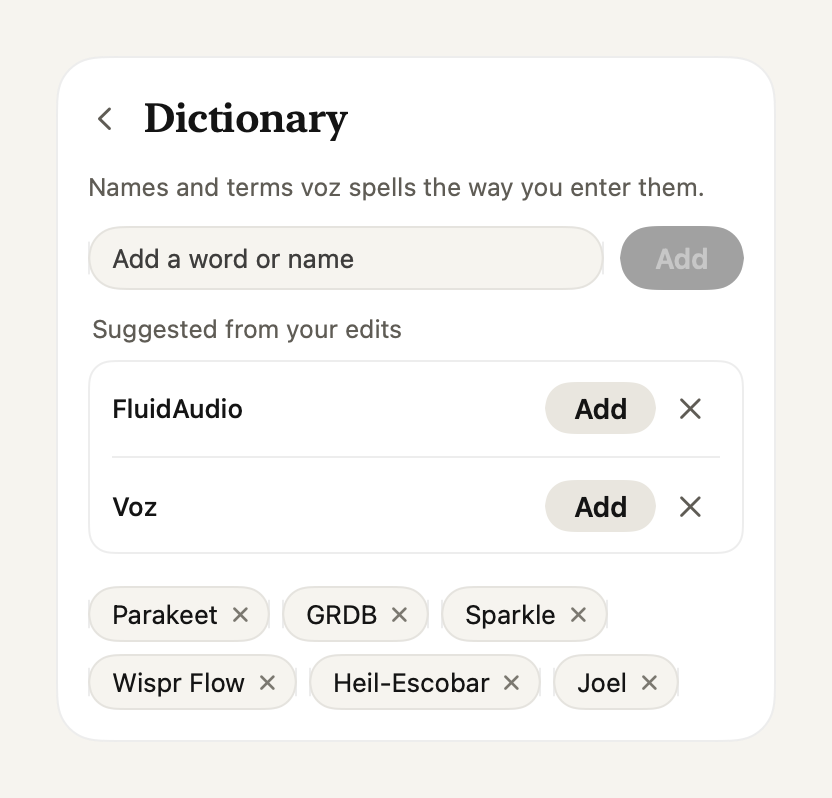

<div align="center">

# Voz

**Talk instead of type, in every app on your Mac.**

[Website](https://voz.joels.tech), [Extensions](https://voz.joels.tech/extensions/)

<picture>
  <source media="(prefers-color-scheme: dark)" srcset=".github/images/ready-dark.png">
  
</picture>

</div>

Voz is free, open source dictation for macOS. It transcribes on your Mac, removes filler words and types the text at your cursor. The core stays small. Everything else is a TypeScript extension.

## Install

You need macOS 26 and Apple Silicon. Paste this in Terminal:

```
curl -fsSL https://voz.joels.tech/install | bash
```

The script downloads the latest release, puts Voz in `/Applications` and opens it. Voz then asks for Microphone, Accessibility and Input Monitoring access. After that it updates itself.

## Usage

Tap right Command, speak, tap again. The text lands at your cursor in whatever app you're using.

Voz lives in the menu bar. The panel shows your recent transcripts, and a click copies one. Insights counts your words and the time you saved. The dictionary sets how Voz spells names, and you can edit the cleanup prompt in Settings.

<p align="center">
  <picture>
    <source media="(prefers-color-scheme: dark)" srcset=".github/images/insights-dark.png">
    
  </picture>
  <picture>
    <source media="(prefers-color-scheme: dark)" srcset=".github/images/dictionary-dark.png">
    
  </picture>
</p>

## How it works

The core records, transcribes, cleans up, inserts and saves history. Speech recognition and cleanup both run on your Mac, so Voz works offline.

Extensions hook in between those steps: after recording, before cleanup, before insert, after insert, and on voice commands. They can also add speech models, cleanup models, cleanup steps, settings forms and panel actions with hotkeys. Bun runs them in a separate process. If you install none or turn them all off, Voz skips the Bun download and starts no extra process. A slow or crashing extension never blocks dictation: after 300 ms, Voz inserts the original text.

## Extensions

Start one with `voz new`, try it with `voz dev`, share it with `npm publish`:

```
voz new voz-hello
voz dev voz-hello
```

An extension is a TypeScript file:

```ts
import { defineExtension } from "voz";

export default defineExtension((voz) => {
  voz.registerCommand("send it", (event, ctx) => ctx.press("return"));
});
```

Say "let's ship it, send it" and Voz types "Let's ship it", then presses Return.

To have a coding agent write one, open it in `~/.voz`. Voz keeps a guide for agents there in `AGENTS.md`. Packages with the `voz-package` keyword show up in the Extensions page and on [voz.joels.tech/extensions](https://voz.joels.tech/extensions/). Install one with `voz install <name>`.

The full API is in [EXTENSIONS.md](EXTENSIONS.md). Extensions run with your permissions, so install only ones you trust.

Packages on npm come from their authors. I do not review them and I am not responsible for them or for npm. Voz never runs install scripts.

## Privacy

Your audio and text stay on your Mac. Voz sends its version number on install and update, and you can turn that off. Usage analytics stay off unless you opt in.

## Contributing

Pull requests to the core are for what every user needs on every dictation: speed, reliability, fixes, languages and extension points. Features that only some people want ship as extension packages.

```
scripts/test.sh          # run the tests
scripts/make-app.sh      # build and sign build/voz.app
```

## License

[MIT](LICENSE)
