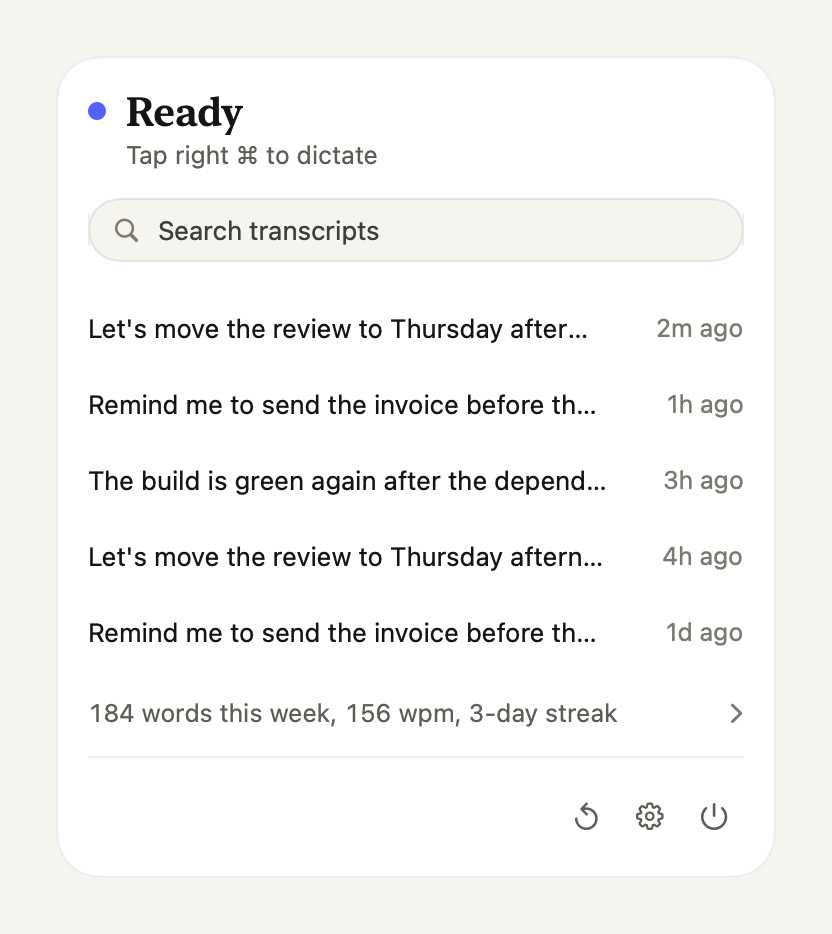

<div align="center">

# Voz

**Simple like Wispr Flow. Extensible like pi.**

Tap right Command and talk. Voz types clean text into any app.<br>
Missing a feature? Tell your coding agent and it writes the extension.<br>
Free and open source. Your audio never leaves your Mac.

[](https://github.com/Joelheile/voz)
[](LICENSE)
[](https://github.com/Joelheile/voz/releases/latest)


[Website](https://voz.joels.tech), [Extensions](https://voz.joels.tech/extensions/)

<a href="https://voz.joels.tech"></a>

[Watch it with sound](https://voz.joels.tech)

</div>

## Install

macOS 26 on Apple Silicon:

```
curl -fsSL https://voz.joels.tech/install | bash
```

If Voz saves you some typing, click **Star** at the top of [the repo page](https://github.com/Joelheile/voz). Stars are how other developers find Voz.

## Why I built Voz

- Paying monthly to talk
- A hundred settings
- Waiting months on your PR

I paid for Wispr Flow until paying a subscription to talk to my own computer started to annoy me. The open source apps I tried felt bloated. Hex came closest. I liked it, but every change I wanted meant a pull request and a long wait.

So I built Voz the way pi works. The core records, transcribes, cleans up and types, and I keep it fast. Anything else is an extension you write for yourself. If it helps someone else, publish it and they can install it from the menu bar.

## How Voz fixes it

- Free and open source: MIT licensed, no account, no weekly word limit.
- A small, fast core that records, transcribes, cleans up and inserts. Nothing else runs on your words.
- Extensions in place of settings. Build what you need and share it, while the core stays small.

## You talk 150 words a minute, you type 40

Tap right Command, talk, tap again. You say:

> um so tell kaitlyn the uh deck is ready

Voz types this at your cursor:

> Tell Kaitlyn the deck is ready.

Voz cuts the "um"s and fixes punctuation. It all runs on your Mac, so it works offline.

## A tiny core that stays fast

<picture>
  <source media="(prefers-color-scheme: dark)" srcset=".github/images/ready-dark.png">
  
</picture>

The core records, transcribes, cleans up, types and saves your history on your Mac.

- Lives in the menu bar
- Click a transcript to copy it, search finds the rest
- Extensions plug in between the steps. Add none and Voz runs nothing extra

## Build the extensions you need, share them with everyone

Extensions are small TypeScript files in `~/.voz/extensions` that can use your apps, files, terminal and the network.

```ts
import { defineExtension } from "voz";

export default defineExtension((voz) => {
  voz.registerCommand({ phrase: "send it", run: (event, ctx) => ctx.press("return") });
});
```

Now "let's ship it, send it" types "Let's ship it" and presses Return. Some other ideas:

- Turn rambling into a clear prompt for your coding agent
- Write mail in your style, with your greeting and sign-off
- File a Linear issue from what you said
- Run a script with a voice command

Extensions run with your permissions, so only install ones you trust. If one is slow or crashes, dictation keeps working.

## Let a coding agent write them

You don't need to learn the API first. Tell a coding agent in `~/.voz` what you want. It reads the guide Voz keeps there and writes the extension. Voz loads it when you save. The full API is in [EXTENSIONS.md](EXTENSIONS.md).

Publish it to npm with the `voz-package` keyword and it shows up in Extensions for everyone. Here is every published extension, updated hourly:

<a href="https://voz.joels.tech/extensions/"></a>

Install one from the menu bar, or run `voz install voz-meeting`. [Browse extensions](https://voz.joels.tech/extensions/) or [build your first one](https://voz.joels.tech/build-extension/).

## What's new

<!-- changelog -->
- Your Voz icon no longer hides behind the notch when your menu bar is full

[See everything new](CHANGELOG.md)
<!-- /changelog -->

## Privacy

Built-in dictation processes audio and transcripts on your Mac. Extensions can send data to external services, so review what you install. Voz sends a version ping on install and update, with a new random ID each time. On each day you dictate, it sends one more ping with the app version, macOS version, chip and speech model, under a random ID stored on your Mac, so active installs can be counted. Neither ping contains what you said, and PostHog does not store your IP address. Usage analytics are off unless you opt in, and they never contain what you said. Crash reports are on by default and have their own setting under Privacy. They send crashes, freezes and fixed error codes with a stack trace, never text, audio or app names.

For debugging, Voz keeps a log on your Mac at `~/Library/Logs/Voz/voz-logs.jsonl`, with one line per dictation: timings, model and app names. It includes what you said only when you turn on Include text under Privacy in Settings. It never leaves your Mac unless you copy it.

To mute other apps while you dictate, Voz asks for System Audio Recording access. It silences their sound and does not save their audio.

Found a vulnerability? Open a [private advisory](https://github.com/Joelheile/voz/security/advisories/new), not a public issue.

## Contributing

The core stays small. Pull requests that make it faster or more reliable, add languages or add extension points are welcome. Everything else ships as an extension. If the API can't do what you need, or something is missing, [open an issue](https://github.com/Joelheile/voz/issues/new).

You need the Command Line Tools, not Xcode:

```
scripts/test.sh          # run the tests
scripts/run.sh           # build a debug app and launch it
scripts/make-app.sh      # build and sign build/voz.app
```

The app is one Swift package target, `Sources/Voz`, with a folder per feature. `AGENTS.md` has the code map.

Pushes to `main` publish a beta and `vX.Y.Z` tags publish a stable release. Keep the signing identity and Sparkle key unchanged and build numbers increasing. To pull a bad update, remove it from `appcast.xml`, then publish a fix.

## License

[MIT](LICENSE). Dependencies and downloaded models retain their own licenses. Signed apps include `Contents/Resources/ThirdPartyNotices.txt`, with dependency licenses and [model attributions](Resources/ModelNotices.txt).
